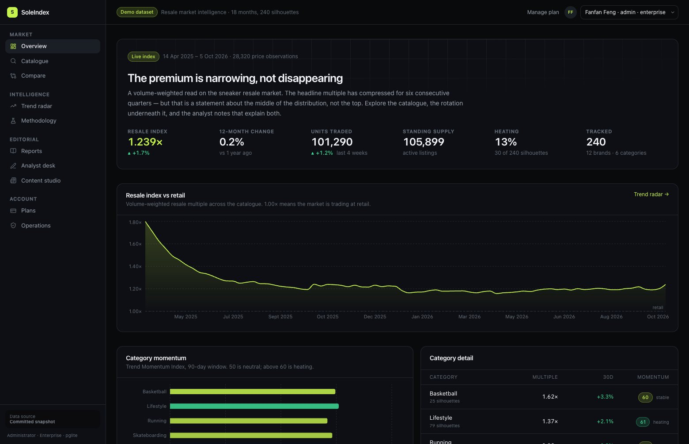
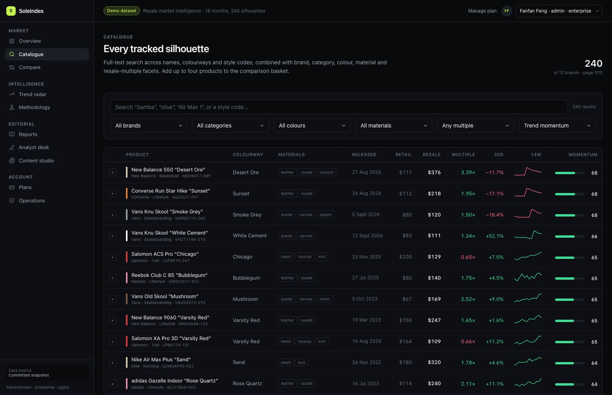
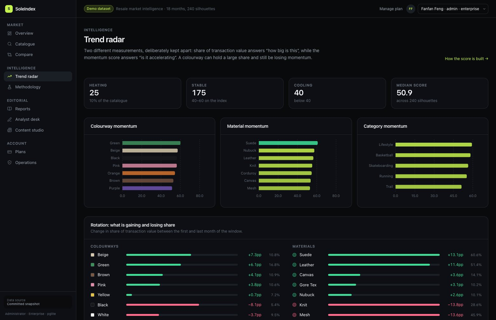

# SoleIndex

**Market intelligence for the sneaker resale market.** Interactive dashboards, a searchable
catalogue with comparison, colourway and material trend radar, an analyst desk for manually
collected observations, and an editorial CMS — built on Next.js, PostgreSQL and a swappable
market-data provider.

<p align="center">
  
</p>

<p align="center">
  
  
</p>

<!--
  A note for anyone reading this repository as a work sample: every claim below
  maps to a route you can open, a file you can read, or a test you can run.
  Nothing here is aspirational.
-->

---

## Run it

```bash
pnpm install
pnpm dev            # http://localhost:3000
```

That is the whole setup. No API key, no database server, no seed step you have to remember:

- **The database is embedded.** [PGlite](https://pglite.dev) is PostgreSQL 18 compiled to WASM. It
  persists to `./.data` and needs no service to install or run.
- **The data is committed.** `fixtures/` holds a ~870 KiB snapshot: 240 silhouettes, 28,320 price
  observations, 18,720 sales observations, 512 attribute-trend points, 12 analyst notes and 8
  reports.
- **Migrations and seeding are automatic** on first request (`src/db/bootstrap.ts`). `pnpm db:reset`
  is there if you want a clean rebuild.

### Everything else

```bash
pnpm verify            # 37 behavioural checks against a running server
pnpm test              # 52 unit tests for the trend index
pnpm typecheck         # tsc --noEmit, strict
pnpm build             # production build (never touches the database)
pnpm db:reset          # drop ./.data, migrate, reseed from fixtures
pnpm analytics:refresh # recompute every Trend Momentum Index
pnpm fixtures:generate # regenerate the demo dataset deterministically
```

### Switching to live market data

```bash
cp .env.example .env.local
# SOLEINDEX_PROVIDER=kicksdb
# KICKSDB_API_KEY=KICKS-XXXX-XXXX-XXXX-XXXXXXXXXXXX
# SOLEINDEX_DB_DRIVER=postgres
# DATABASE_URL=postgres://...
```

No code changes. The provider and the database driver are both selected by environment variable —
see [`docs/adr/0001-provider-adapter.md`](docs/adr/0001-provider-adapter.md) for why, and what is and
is not verified about the live adapter.

---

## Requirement → implementation

This is the map from a feature list to the thing that satisfies it. Each row names a route you can
open and the file that implements it.

| Requirement | Route | Implementation | Verified by |
| --- | --- | --- | --- |
| Premium, minimal, dark interactive dashboard | `/` | [`globals.css`](src/app/globals.css) design tokens · [`page.tsx`](src/app/page.tsx) | screenshot above |
| External API integration for historical pricing | `/products/[slug]` | [`providers/`](src/lib/providers) — one interface, two implementations | [`fixtures:generate`](scripts/generate-fixtures.ts) round-trips |
| Structured product database | `/products` | 16-table Postgres schema, [`schema.ts`](src/db/schema.ts) | migrations apply on boot |
| Advanced search and filtering | `/products?q=…` | `websearch_to_tsquery` + `ILIKE` fallback, five facets, eight sort keys | live |
| Comparison tools | `/compare?ids=…` | rebased multi-series chart + attribute diff | live |
| Analytics: interactive charts, rankings, history | `/`, `/trends` | Recharts; SQL aggregates in [`data/`](src/lib/data) | live |
| Trend indicators | `/trends` | **Trend Momentum Index** | [52 unit tests](src/lib/analytics/tmi.test.ts) |
| Trend intelligence: categories, colours, materials, preferences | `/trends` | [`attribute_trends`](src/db/schema.ts) derived from transaction value | live |
| Methodology is inspectable | `/trends/methodology` | weights and constants imported from the model, not retyped | [`methodology/page.tsx`](src/app/trends/methodology/page.tsx) |
| Custom admin: manual observations **linked to records** | `/admin` | `insights` + polymorphic `insight_links` | link a note, see it on three pages |
| Editorial CMS: articles, trend reports, analyses | `/admin/editorial`, `/editorial` | Markdown authoring, draft → publish, derived reading time | live |
| Scalable architecture: subscriptions, tiers, AI-ready | `/pricing` | `feature_flags` + server-side entitlement gate | shown below |

---

## Three things worth looking at

### 1. The Trend Momentum Index

A 0–100 score per product, colourway, material, category and brand. Five normalised factors,
published weights, an OLS fit rather than a first-vs-last comparison, and — the part that matters —
**a total function**: an empty window, a single print, a constant price or a zero-volume product all
return a well-formed result with an explanatory note rather than `NaN` or a confident-looking lie.

| Factor | Weight | Lead / lag |
| --- | --- | --- |
| Price velocity | 35% | lagging |
| Volume delta | 25% | independent |
| Stability (inverse volatility) | 15% | lagging |
| Sell-through | 15% | **leading** |
| Attention | 10% | independent |

The design brief came from the observation that **price is a lagging indicator** — supply arrives
before it clears, and price is what adjusts afterwards. So the score deliberately blends lagging and
leading signals, and never extrapolates.

- Model: [`src/lib/analytics/tmi.ts`](src/lib/analytics/tmi.ts)
- Tests: [`tmi.test.ts`](src/lib/analytics/tmi.test.ts) — asserts direction *and* honesty on
  degenerate input
- Specification, calibration constants, worked example and **known limitations**:
  [`/trends/methodology`](src/app/trends/methodology/page.tsx)

Writing down the failure modes was the point. A metric that cannot survive being specified should
not be driving decisions.

### 2. An analyst note that lands on three pages from one write

The brief asked for observations "linked to existing database records", which is trivial to fake
with a free-text field. Here the link is a real row:

```sql
insight_links(insight_id, entity_type, entity_id)   -- product | category | color | material | brand
```

Author one note on `/admin` attached to the colourway *olive*, and it appears on the trend radar, on
the product pages carrying that colour, and on the category list — without being duplicated,
re-entered, or kept in sync by hand. `getInsightsForEntity()` is the whole mechanism
([`editorial.ts`](src/lib/data/editorial.ts)).

### 3. A paywall that is actually a paywall

Tiers are rows in `feature_flags`, and the gate is evaluated **server-side before the query runs**.
A free session requesting `/trends` returns the locked panel and the trend data is never fetched, so
it never reaches the client:

```
$ curl -H "Cookie: si_session=<free-tier>"  /trends   →  HTTP 200,  38 KB, no chart markup
$ curl -H "Cookie: si_session=<pro-tier>"   /trends   →  HTTP 200, 138 KB, full charts
```

The 100 KB difference is the gate working. Blurring content the browser already has is the most
common way a paywall demo turns out to be decorative; this one is not. Switch persona in the header,
or from `/login`, to see it.

### Falsify it yourself

```bash
pnpm dev          # in one terminal
pnpm verify       # in another — 37 assertions against the running app
```

`scripts/verify.sh` builds three HMAC-signed session cookies, then asserts the claims above rather
than describing them: that the free tier's response omits the chart markup entirely, that an
unpublished report 404s for a viewer but renders for an editor, and that a tampered cookie is demoted
to least privilege instead of falling back to the most privileged persona. If any of that were
decorative, the script would fail.

---

## Architecture

```
src/
├── app/                     routes; every one is a Server Component by default
├── components/              shell, cards, charts, forms — 2 client components total
├── db/
│   ├── schema.ts           16 tables, Postgres dialect
│   ├── client.ts           driver factory: PGlite (local) | postgres (Neon/RDS)
│   ├── bootstrap.ts        migrate + seed on first request, memoised
│   └── seed.ts             idempotent, batched, ~1.2 s for 47k rows
└── lib/
    ├── analytics/tmi.ts    the trend model — pure, no I/O, unit tested
    ├── analytics/refresh.ts  the only module that reads observations and writes scores
    ├── auth/               signed-cookie session + tier entitlements
    ├── data/               read models: raw SQL for aggregates, Drizzle for CRUD
    └── providers/          MarketDataProvider contract, fixture + kicksdb implementations
```

Four decisions are worth the reader's time, and each has a document:

| Decision | Why | Document |
| --- | --- | --- |
| Embedded PostgreSQL instead of SQLite | Identical semantics to production, so migrations and SQL are not a rewrite on deploy | [architecture](docs/architecture.md#why-embedded-postgresql) |
| Fixture provider as the default | A demo that dies when a free-tier quota runs out is not a demo; a live endpoint cannot be unit tested | [ADR-0001](docs/adr/0001-provider-adapter.md) |
| Raw SQL for aggregates, Drizzle for CRUD | Window functions and lateral joins are less safe to express through a query builder than to write | [architecture](docs/architecture.md#query-strategy) |
| Server-rendered everything | Filtering, comparison selection and the paywall are all URL state; the app ships **two** client components | [architecture](docs/architecture.md#render-strategy) |

---

## Honest status

Everything in the table above is implemented and runs. This section is what is *not* finished, so
nobody has to discover it.

| Area | State | What is missing |
| --- | --- | --- |
| Live KicksDB adapter | Written, **not executed against a live key** | No account was available. Endpoint shapes follow the published v3 reference; `pnpm ingest --dry-run` exercises the request path so responses can be confirmed against a real plan. |
| Scheduling | Adapter, run log and quota capture implemented | No cron trigger — the ingestion history on `/admin/ops` is seeded so the surface can be evaluated. |
| Stripe | `subscriptions` table is shaped like a Stripe subscription | No integration. Needs real credentials and webhooks; the tier model is in place. |
| Auth | Real HMAC-signed sessions, three personas | Not OAuth. Swapping in Auth.js replaces one module — call sites only use `getSession()` and `hasTier()`. |
| Editorial rich text | Markdown authoring, full render | No WYSIWYG and no image upload. Both belong to a purpose-built integration, not a half-built one. |
| Mobile | Responsive to 360 px, mobile nav bar | Not designed mobile-first; the dense tables are the weakest case. |
| AI insights | Flagged as `ai.summaries` (Enterprise) | Not implemented. |

### About the dataset

Product names reference **real silhouettes**. Every price, volume and listing figure is
**synthetic**, produced by a seeded generator ([`scripts/generate-fixtures.ts`](scripts/generate-fixtures.ts))
so the demo and the test suite are reproducible offline and byte-identical across runs. The
generator applies a documented colour/material rotation so the trend pages tell a coherent story
that is still *derived* from the price series rather than hand-authored into the charts.

Market state in the committed snapshot: index **1.440× → 1.163×** retail over 18 months (−19.2%;
−10.5% over 12 months), median multiple **1.00×**, **119 of 240** silhouettes trading below retail,
top decile 2.06×.

---

## Stack

Next.js 16 (App Router, RSC, Server Actions) · React 19 · TypeScript 5.9 strict · Tailwind CSS 4 ·
Recharts · Drizzle ORM · PostgreSQL (PGlite locally, Neon in production) · Zod · Vitest · GitHub
Actions.

MIT licensed.
